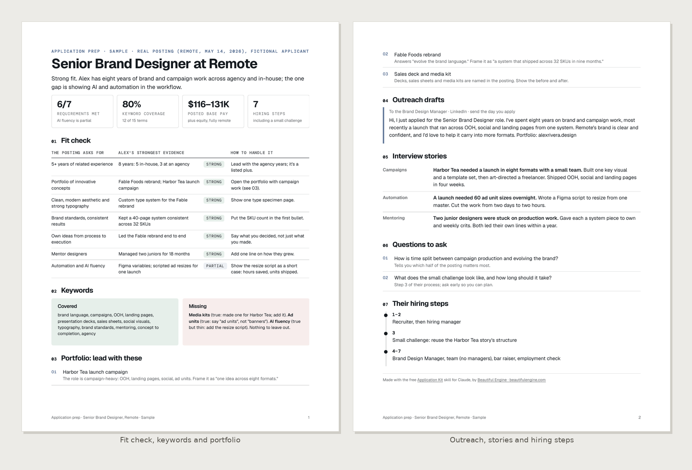
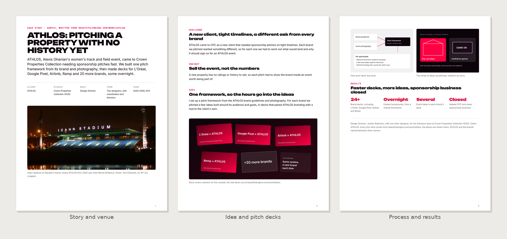
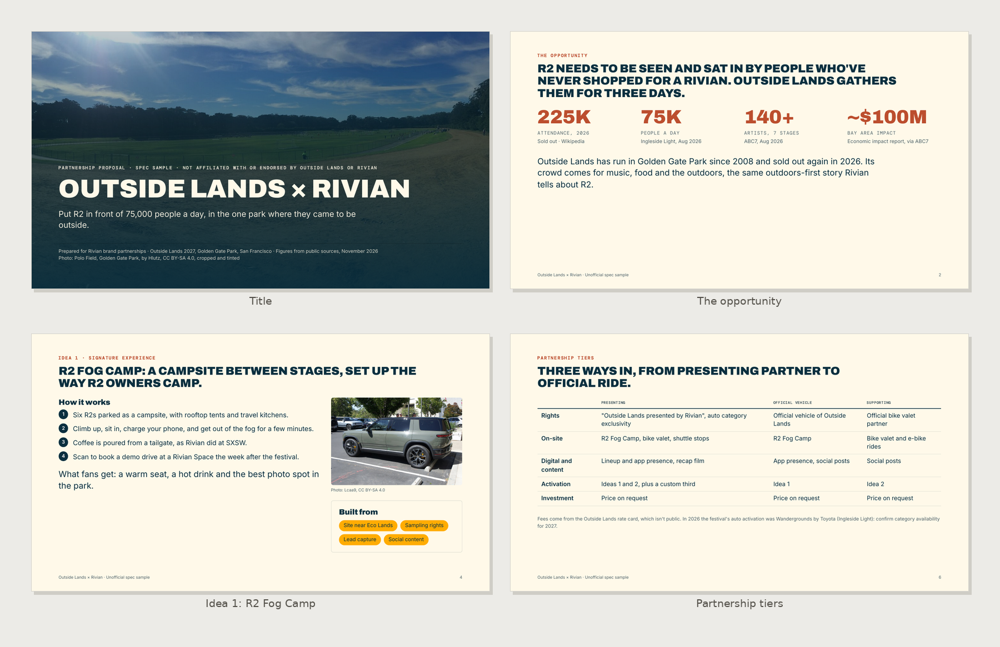
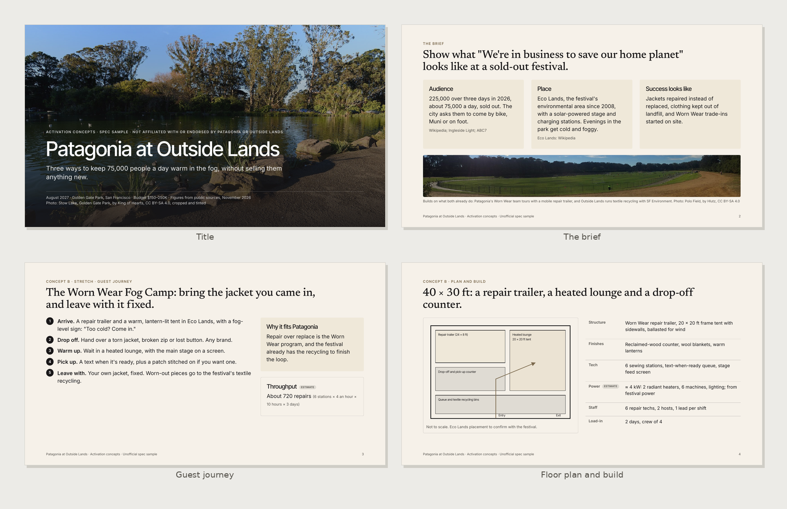
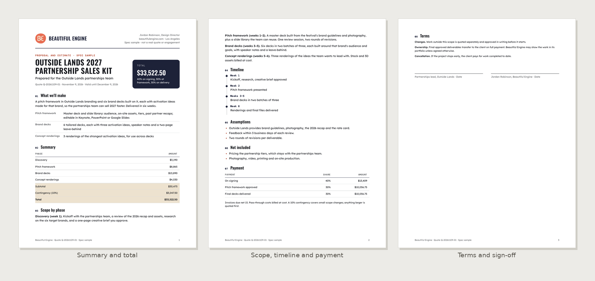
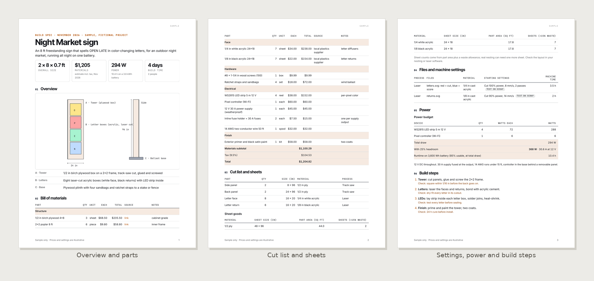
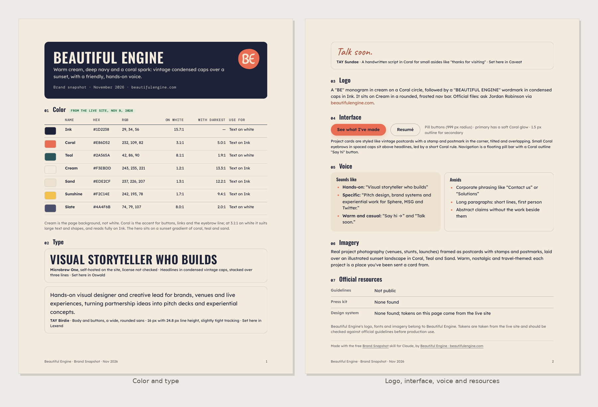
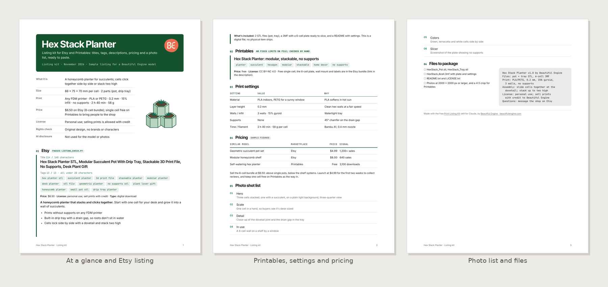

# Beautiful Engine skills

Claude skills made by [Beautiful Engine](https://www.beautifulengine.com), a creative studio in Los Angeles working across brand, experiential and interactive design. They cover the work around the work: researching a company, landing the job, pitching the partnership, pricing it, building it, and selling what you make.

**Website:** [beautifulengine.com](https://www.beautifulengine.com) · **Questions, ideas, or something broke?** [Open an issue](https://github.com/BeautifulEngine/skills/issues/new)

## Skills

| Skill | What you get | Try asking | Its own page |
|---|---|---|---|
| **Company Brief** | A designed, sourced PDF on any company in its own brand colors, plus a one-page cheat sheet and a brand kit | "Make me a company brief on Figma." | [Get it](https://github.com/BeautifulEngine/company-brief) |
| **Application Kit** | A tailored resume and cover letter (Word and PDF), a fit check, portfolio picks, outreach drafts and a follow-up plan | "Tailor my resume for this posting: <link>." | [Get it](https://github.com/BeautifulEngine/application-kit) |
| **Case Study** | A portfolio case study as a web page, PDF and Markdown, tailored to a company if you like | "Write a case study for this project. Notes attached." | [Get it](https://github.com/BeautifulEngine/case-study) |
| **Sponsorship Pitch** | A 16:9 partnership deck: why the brand and property fit, three activation ideas, tiers, measurement, plus speaker notes | "Sponsorship deck: Rivian x Outside Lands." | [Get it](https://github.com/BeautifulEngine/sponsorship-pitch) |
| **Activation Concepts** | Three experiential concepts with guest journey, floor plan, build notes, budget range and risks | "Three activation concepts for Patagonia at a music festival, $150–250K." | [Get it](https://github.com/BeautifulEngine/activation-concepts) |
| **Project Quote** | A branded quote and SOW with phases, rates, payment schedule and terms, totals computed by a script; also rate cards | "Quote a brand identity for a coffee roaster, 6 weeks." | [Get it](https://github.com/BeautifulEngine/project-quote) |
| **Build Spec** | A fabrication package: BOM with costs, cut list and sheet counts, laser and print settings, power budget, build steps, safety | "Build spec for an 8 ft LED sign that runs on a battery." | [Get it](https://github.com/BeautifulEngine/build-spec) |
| **Brand Snapshot** | A two-page brand reference from any website: colors with contrast checks, fonts and stand-ins, logo notes, voice, plus design tokens | "Brand snapshot for linear.app." | [Get it](https://github.com/BeautifulEngine/brand-snapshot) |
| **Print Listing Kit** | Ready-to-paste 3D model listings for Etsy, Printables, MakerWorld and more, with tags checked against limits, pricing and a photo list | "Listing kit for my hex planter STL." | [Get it](https://github.com/BeautifulEngine/print-listing-kit) |

Every skill has its own page with examples and its Claude app download, linked in the last column. They work well together: run Company Brief before Application Kit or Sponsorship Pitch, take an Activation Concept into a Build Spec, and price either with Project Quote.

## See what they make

Pages from a sample of each, made with real brands. The pitch and activation samples are unofficial spec work in each brand's colors, with figures from public sources and credited, freely licensed photos ([credits](tools/samples/photos/CREDITS.md)); they aren't affiliated with or endorsed by the brands named. Case Study and Brand Snapshot cover Beautiful Engine's own work and site. Click one for the full PDF, or open "how to ask" for a short animation of requests that work.

<table>
<tr><td width="33%" valign="top"><a href="https://github.com/BeautifulEngine/company-brief"></a><br><b>Company Brief</b> · <a href="https://github.com/BeautifulEngine/company-brief/tree/main/examples">samples</a></td><td width="33%" valign="top"><a href="examples/application-kit/Sample-Remote-Senior-Brand-Designer-Application-Prep.pdf"></a><br><b>Application Kit</b> · <a href="examples/application-kit/Sample-Remote-Senior-Brand-Designer-Application-Prep.pdf">sample PDF</a> · <a href="docs/application-kit/how-to-ask.gif">how to ask</a></td><td width="33%" valign="top"><a href="examples/case-study/Sample-ATHLOS-Case-Study.pdf"></a><br><b>Case Study</b> · <a href="examples/case-study/Sample-ATHLOS-Case-Study.pdf">sample PDF</a> · <a href="docs/case-study/how-to-ask.gif">how to ask</a></td></tr>
<tr><td width="33%" valign="top"><a href="examples/sponsorship-pitch/Sample-Outside-Lands-x-Rivian-Partnership-Pitch.pdf"></a><br><b>Sponsorship Pitch</b> · <a href="examples/sponsorship-pitch/Sample-Outside-Lands-x-Rivian-Partnership-Pitch.pdf">sample PDF</a> · <a href="docs/sponsorship-pitch/how-to-ask.gif">how to ask</a></td><td width="33%" valign="top"><a href="examples/activation-concepts/Sample-Patagonia-at-Outside-Lands-Activation-Concepts.pdf"></a><br><b>Activation Concepts</b> · <a href="examples/activation-concepts/Sample-Patagonia-at-Outside-Lands-Activation-Concepts.pdf">sample PDF</a> · <a href="docs/activation-concepts/how-to-ask.gif">how to ask</a></td><td width="33%" valign="top"><a href="examples/project-quote/Sample-Beautiful-Engine-Quote-Outside-Lands.pdf"></a><br><b>Project Quote</b> · <a href="examples/project-quote/Sample-Beautiful-Engine-Quote-Outside-Lands.pdf">sample PDF</a> · <a href="docs/project-quote/how-to-ask.gif">how to ask</a></td></tr>
<tr><td width="33%" valign="top"><a href="examples/build-spec/Sample-Night-Market-Sign-Build-Spec.pdf"></a><br><b>Build Spec</b> · <a href="examples/build-spec/Sample-Night-Market-Sign-Build-Spec.pdf">sample PDF</a> · <a href="docs/build-spec/how-to-ask.gif">how to ask</a></td><td width="33%" valign="top"><a href="examples/brand-snapshot/Beautiful-Engine-Brand-Snapshot-2026-11.pdf"></a><br><b>Brand Snapshot</b> · <a href="examples/brand-snapshot/Beautiful-Engine-Brand-Snapshot-2026-11.pdf">sample PDF</a> · <a href="docs/brand-snapshot/how-to-ask.gif">how to ask</a></td><td width="33%" valign="top"><a href="examples/print-listing-kit/Sample-Hex-Stack-Planter-Listing-Kit.pdf"></a><br><b>Print Listing Kit</b> · <a href="examples/print-listing-kit/Sample-Hex-Stack-Planter-Listing-Kit.pdf">sample PDF</a> · <a href="docs/print-listing-kit/how-to-ask.gif">how to ask</a></td></tr>
</table>

## Install in the Claude app (web or desktop)

1. Turn on **Settings > Capabilities > "Code execution and file creation"**.
2. Open the skill's page from the table above and download its zip (or grab it from [dist/](dist/) here). Don't unzip it.
3. Go to **Customize > Skills**, click **+**, then **+ Create skill > Upload a skill**, and upload the zip.
4. Start a new chat and ask in plain words. Claude picks the right skill on its own.

Each skill installs on its own, so add only the ones you'll use.

## Install in Claude Code

```bash
claude plugin marketplace add BeautifulEngine/skills
claude plugin install beautiful-engine@beautiful-engine
```

Inside a session you can do the same with `/plugin marketplace add BeautifulEngine/skills`, then `/plugin install beautiful-engine@beautiful-engine`. Use each skill with the `beautiful-engine:` prefix, or just ask in plain words:

```
/beautiful-engine:company-brief linear.app
/beautiful-engine:application-kit https://jobs.example.com/design-lead
/beautiful-engine:sponsorship-pitch Rivian x Outside Lands
/beautiful-engine:project-quote rate card
```

To get updates and new skills:

```bash
claude plugin marketplace update beautiful-engine
claude plugin update beautiful-engine@beautiful-engine
```

## How they behave

- **Nothing invented.** Facts and numbers come from sources, with dates, or from you. Results, rates, audience figures and experience are never made up; gaps are marked and listed for you to fill.
- **Math by script.** Quotes, bills of materials, power budgets, color contrast and listing limits are calculated by small scripts, not estimated in prose.
- **Brands respected.** Logos and brand artwork are described and linked, never copied. Your own logo can go on your own quote.
- **Checked before delivery.** Every PDF is rendered, audited for fonts, text contrast and leftover blanks, and looked at page by page.
- **Credit line.** Documents you keep for yourself (Company Brief, Brand Snapshot, Build Spec, the Application Kit prep sheet) end with a small "Made with … by Beautiful Engine" line. Say "no credit line" to leave it out. Anything you send to a client or employer never carries it.

## For maintainers

```
.claude-plugin/marketplace.json            the catalog Claude Code reads
plugins/beautiful-engine/
├── .claude-plugin/plugin.json             plugin name, description, author, website
└── skills/<skill>/                        SKILL.md, assets/, scripts/, references/
shared/                                    scripts, stylesheets and references every skill uses
scripts/build.sh                           copies shared/ into each skill, writes READMEs, builds dist/*.zip
scripts/sync-skill.sh                      pulls Company Brief in from its own repo
dist/                                      one zip per skill for the Claude app
```

- **After editing anything:** run `scripts/build.sh`, then `claude plugin validate .`, then commit and push. Edit shared files in `shared/`, not inside a skill.
- **Publish to a skill's own repo** (BeautifulEngine/<skill>) after `scripts/build.sh`: clone that repo, run `scripts/publish-standalone.sh <skill> <path to the clone>`, then commit and push there. It copies the skill folder and zip, and regenerates the landing README and LICENSE. Edit skills here, never in their own repos.
- **Update Company Brief** after changing it in its own repo: `scripts/sync-skill.sh ../company-brief/company-brief company-brief`.
- **Add a new skill:** create `plugins/beautiful-engine/skills/<name>/SKILL.md` (with `## Usage`) and its assets, run `scripts/build.sh`, and add a row to the table above. Name skills for what they do, lowercase with hyphens.

The plugin has no `version` field on purpose, so every push reaches people when they update. The validator warns about it; that's expected.

## License

MIT. See [LICENSE](LICENSE).
